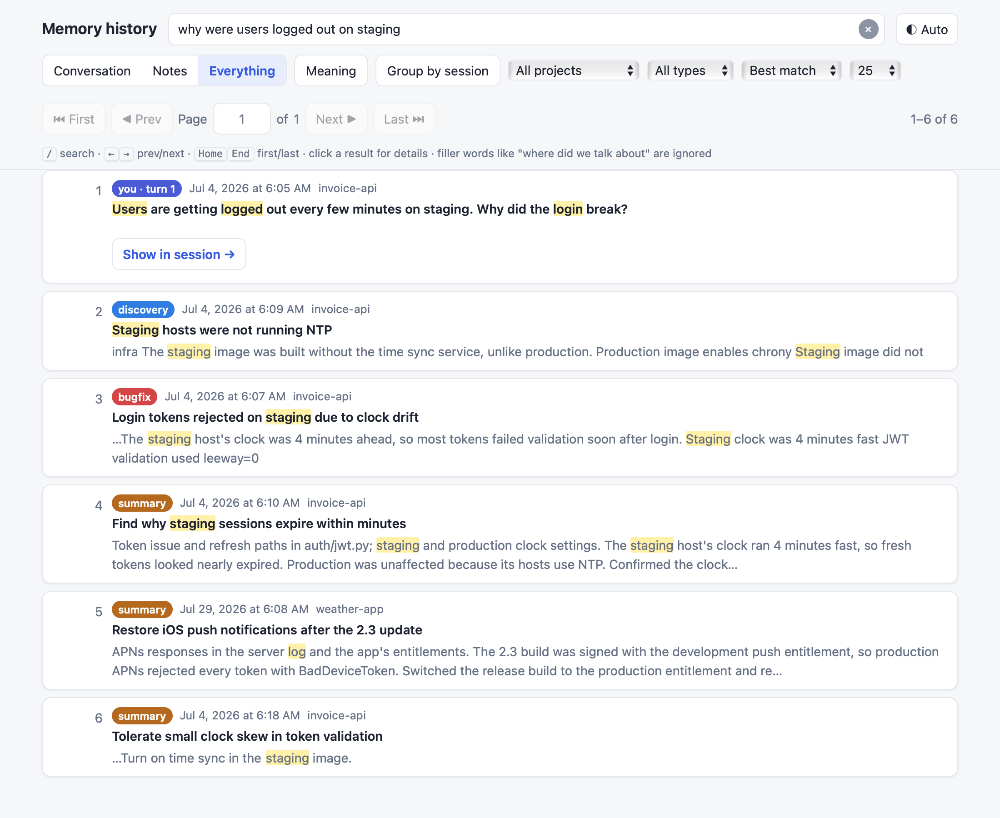
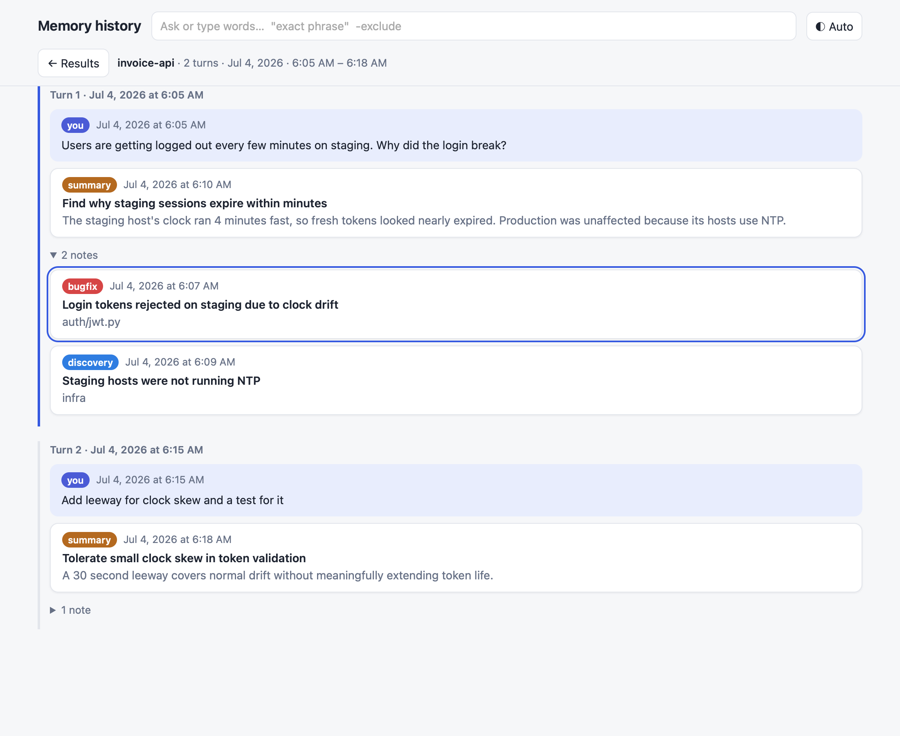
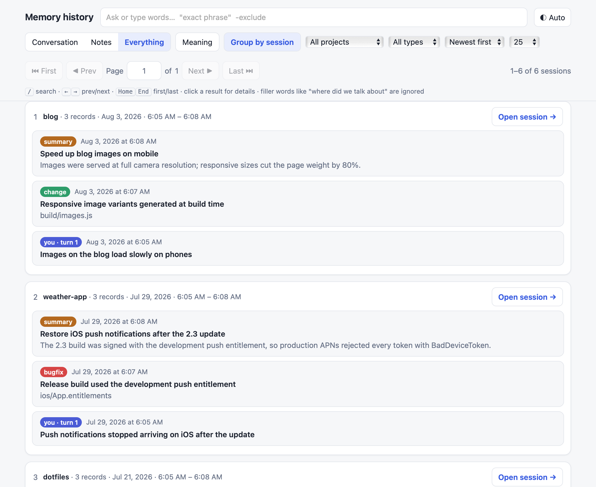
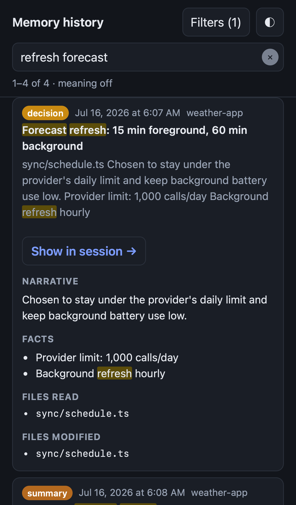

# claude-mem history search

A local web page for finding things in your [claude-mem](https://github.com/thedotmack/claude-mem)
history, across all your projects: observations, session summaries and your own prompts. Ask it the way
you'd ask a person, like *"where did we decide how often to refresh the forecast?"*, and it shows the
best matches first.



*All screenshots use invented demo data ([`tests/demo.py`](tests/demo.py)).*

## What it does

- **Ranked search.** Filler words like "where did we talk about" are dropped, words are stemmed
  ("samples" finds "sampling"), and titles count more. Use `"exact phrase"` for a phrase and `-word` to
  leave a word out.
- **Typo tolerance.** "recieve" also tries "receive", using words that already appear in your history.
- **Meaning search.** It also asks claude-mem's own worker for meaning-based results (its Chroma
  vectors) and merges them in, so a search can find a note that uses different words.
- **Three modes.** Conversation (what you asked and the per-turn summaries), Notes (observations and
  summaries) or Everything. You can also filter by project or observation type, and sort by best match,
  newest or oldest.
- **Session view.** Opens any result's whole session, turn by turn, with the match outlined.
- **Group by session.** One card per session, with its best matches.
- **Phone-friendly**, with light and dark themes. It can be reached from your other devices through
  [Tailscale](https://tailscale.com) (optional).
- **Read-only, local, no dependencies.** It never writes to claude-mem's database. It runs on Python's
  standard library and serves one HTML page, with no build step, no external requests and no telemetry.

| Session view | Grouped by session | Phone, dark |
|---|---|---|
|  |  |  |

## Requirements

- **claude-mem**, installed and recording. Tested with claude-mem 13.40. At start-up it checks the
  database has the tables and columns it reads, and says what's missing if not.
- **Python 3.9 or newer** with SQLite FTS5. macOS's own `/usr/bin/python3` works, as do the usual
  Homebrew and Linux builds. There's nothing to `pip install`.
- **macOS** for the start-at-login installer. The server itself should run on Linux, but that's
  untested (see [Install](docs/install.md)).

## Quick start

```sh
git clone https://github.com/NarlySoftware/claude-mem-history-search.git
cd claude-mem-history-search
python3 -I server.py
```

Open **http://localhost:37690**. The first start builds a search index from your claude-mem database
(a few seconds per 50,000 records). After that, new records are picked up every 10 seconds.

To start it at login on macOS, run `./install.sh`. See [Install](docs/install.md) for the details.

## Documentation

| | |
|---|---|
| [Install](docs/install.md) | Running it, start at login, options, how it finds claude-mem, using it from other devices, updating and removing |
| [User guide](docs/user-guide.md) | The page: modes, filters, results, session view, grouping, keyboard, links |
| [Search syntax](docs/search.md) | How queries are read and ranked: filler words, stemming, phrases, exclusions, typos, meaning search |
| [API](docs/api.md) | The JSON API the page uses, which you can use too |
| [How it works](docs/how-it-works.md) | The index, privacy and security, performance, benchmark results, limits |
| [Troubleshooting](docs/troubleshooting.md) | Common problems and what to do about them |
| [Contributing](CONTRIBUTING.md) | Tests, the demo database, the benchmark, code style |

## Privacy

Your claude-mem database holds your full conversation history, so this tool is built to keep it on
your machine:

- The server only listens on `127.0.0.1`.
- It refuses requests whose `Host` isn't local, which blocks DNS-rebinding attacks.
- Through Tailscale, it answers only your own login.
- The only network call it makes is to claude-mem's worker on the address claude-mem itself uses.

Don't bind it to `0.0.0.0` or put it behind a public proxy. See
[How it works](docs/how-it-works.md#privacy-and-security).

## License

MIT. See [LICENSE](LICENSE). This project isn't affiliated with claude-mem; it reads claude-mem's
database and asks its worker, both read-only.
